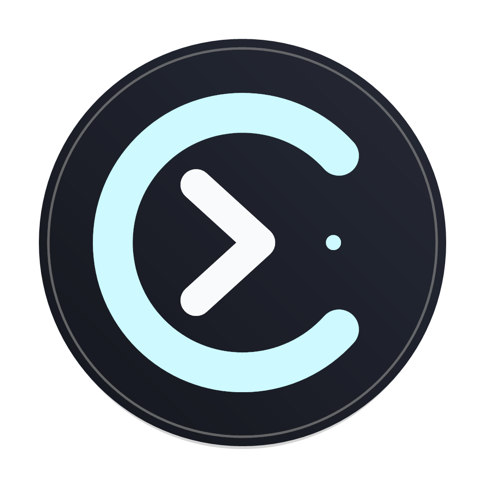

<div align="center">



# codex-chinese

**强制 Codex 桌面应用使用内置 `zh-CN` 中文界面**

原生 MSIX 启动 · 长驻 CDP 注入 · 页面刷新自恢复 · Windows 登录自启

[GitHub](https://github.com/zhenglei410/codex-chinese) ·
[Gitee 国内推荐](https://gitee.com/zhenglei410/codex-chinese)

[](https://github.com/zhenglei410/codex-chinese/actions/workflows/ci.yml)
[](https://go.dev)
[](LICENSE)

</div>

## 一句话给 AI

### 国内 AI（Gitee 推荐）

> 请打开并完整阅读 `https://gitee.com/zhenglei410/codex-chinese/blob/master/AGENTS.md`，
> 按照仓库中的 `AGENTS.md` 和 `docs/AI_DEPLOY.md` 完成 Codex 中文工具的构建、安装、
> 托盘接管和验证。最终必须运行 `codex-chinese.exe -verify`，退出码为 `0` 且输出
> `PASS`，才能报告部署成功。

### 海外 AI（GitHub 推荐）

> 请打开并完整阅读 `https://github.com/zhenglei410/codex-chinese/blob/main/AGENTS.md`，
> 按照仓库中的 `AGENTS.md` 和 `docs/AI_DEPLOY.md` 完成 Codex 中文工具的构建、安装、
> 托盘接管和验证。最终必须运行 `codex-chinese.exe -verify`，退出码为 `0` 且输出
> `PASS`，才能报告部署成功。

仓库地址：

```text
Gitee（国内推荐）: https://gitee.com/zhenglei410/codex-chinese
GitHub:
https://github.com/zhenglei410/codex-chinese
```

## 这是什么

Codex 桌面应用自带中文语言包，但界面是否启用 i18n 由 Statsig 的
`Layer` / `DynamicConfig`（`72216192`）控制。当远程配置不可用时，Codex 可能回退英文。

`codex-chinese` 只处理这一问题：

- 让 `enable_i18n` 返回 `true`；
- 让 `locale_source` 返回 `SYSTEM`；
- 将 Codex 语言覆盖为 `zh-CN`；
- 保持后台注入会话，使页面刷新后仍能恢复中文。

它不修改 `WindowsApps`、`app.asar`、Codex 安装文件或 Codex 认证信息。

## 当前实现

`v2.0.7` 包含以下关键机制：

1. **原生 MSIX 激活**：通过 Windows `IApplicationActivationManager` 和动态解析的 AUMID
   启动商店版 Codex，不依赖 PowerShell/C# 临时脚本。
2. **受控实例复用**：启动前先查找已有 Codex CDP 实例，避免重复选择端口后误杀正常实例。
3. **全局单实例**：启动器和注入守护进程都有跨端口互斥锁，防止多个守护循环重启 Codex。
4. **长驻注入**：在当前文档执行 prelude，同时注册到后续文档；守护进程断线后自动重连。
5. **不强制刷新首屏**：避免打断 Electron bootstrap。
6. **分阶段语言设置**：`localeOverride` 使用有界重试，避免应用 API 尚未就绪时静默失败。
7. **托盘守护**：托盘常驻时，Codex 重新启动后会再次自动接管。
8. **登录自启**：Windows 安装器写入当前用户登录启动项。
9. **独立应用图标**：托盘、桌面和开始菜单使用项目自己的深色青蓝图标。

详细原理见 [`docs/ARCHITECTURE.md`](docs/ARCHITECTURE.md)。

## Windows 快速部署

### 方式一：给 AI 执行

把仓库链接和下面这句话交给 AI：

> 阅读 `https://gitee.com/zhenglei410/codex-chinese/blob/master/AGENTS.md`，
> 如果 Gitee 不可用则改用 `https://github.com/zhenglei410/codex-chinese/blob/main/AGENTS.md`，
> 按仓库中的 AI 部署流程完成构建、安装和校验。

AI 会读取 `AGENTS.md`，执行 `scripts/ai_deploy.ps1`，并以 `-verify` 退出码 `0` 作为完成标准。

### 方式二：从源码手动安装

需要 Git、Go 1.21+；Node.js 仅用于注入脚本回归测试。

```powershell
git clone https://gitee.com/zhenglei410/codex-chinese.git
cd codex-chinese

powershell -NoProfile -ExecutionPolicy Bypass `
  -File scripts\ai_deploy.ps1 -Version v2.0.7
```

脚本会：

- 构建 8 个平台产物；
- 运行 `go vet` 和 prelude 测试；
- 生成 `dist/SHA256SUMS`；
- 安装 CLI 与托盘；
- 创建桌面快捷方式；
- 配置当前用户登录自启动。

默认不会立刻结束正在运行的 Codex。要让中文立即生效，重启 Codex，或双击桌面
「Codex 中文」让托盘自动接管。

### 方式三：如果已发布对应 Release

```powershell
powershell -NoProfile -ExecutionPolicy Bypass `
  -File scripts\install_windows.ps1 -Version v2.0.7 -Mode tray
```

## 校验

重启 Codex 后执行：

```powershell
& "$env:LOCALAPPDATA\Programs\codex-chinese\codex-chinese.exe" -verify
```

成功输出：

```text
verify: installed=true lang=zh-CN i18n=true html=zh-CN
PASS
```

**退出码必须为 `0`。** 程序打印“完成”或窗口能打开都不算成功。

## 使用

### Windows 托盘

双击桌面「Codex 中文」。

- 托盘会自动启动并接管 Codex；
- 如果 Codex 已运行但没有调试端口，会重启一次；
- 托盘常驻期间，Codex 关闭后再次打开时会自动重新接管；
- 右键菜单提供「启动并强制中文」「环境诊断」「退出」。

安装位置：

```text
%LOCALAPPDATA%\Programs\codex-chinese
```

### CLI

```powershell
codex-chinese.exe
codex-chinese.exe -verify
codex-chinese.exe -doctor
```

### 参数

| 参数 | 说明 |
|---|---|
| `-codex <path>` | 手动指定 Codex 可执行文件或安装目录 |
| `-port <n>` | 指定 CDP 端口；默认自动复用或选择 `9229-9258` |
| `-wait <n>` | 等待启动和校验的秒数，默认 `45` |
| `-no-launch` | 只操作已开放 CDP 的实例 |
| `-no-restart` | Codex 未开 CDP 时只报错，不自动重启 |
| `-doctor` | 环境诊断 |
| `-verify` | 校验中文注入；退出码 `0` 为成功 |
| `-version` | 输出版本 |

## 日志

```text
%TEMP%\codex-chinese-tray.log
%TEMP%\codex-chinese-supervisor.log
```

故障处理见 [`docs/TROUBLESHOOTING.md`](docs/TROUBLESHOOTING.md)。

## 支持平台

| 平台 | CLI | 托盘守护 |
|---|---|---|
| Windows x64 / ARM64 | 是 | 是 |
| macOS Intel / Apple Silicon | 是 | 否 |
| Linux x64 / ARM64 | 是 | 否 |

Windows 商店/MSIX 版是当前重点验证目标。

## 构建与测试

```powershell
$env:VERSION="v2.0.7"
.\build.ps1
go vet ./...
node test/prelude.test.mjs
```

或：

```bash
VERSION=v2.0.7 bash build.sh
go vet ./...
node test/prelude.test.mjs
```

产物输出到 `dist/`，共 8 个文件。

## 卸载

```powershell
powershell -NoProfile -ExecutionPolicy Bypass `
  -File scripts\install_windows.ps1 -Uninstall
```

卸载会删除：

- `%LOCALAPPDATA%\Programs\codex-chinese`
- 桌面和开始菜单快捷方式
- `HKCU\Software\Microsoft\Windows\CurrentVersion\Run\CodexChinese`

不会修改 Codex 本体。

## 安全边界

- 只连接 `127.0.0.1` 上的 CDP 端口。
- 不读取、记录或上传 Codex API Key、登录令牌或对话内容。
- 不修改 Codex 安装目录和认证配置。
- 不请求管理员权限。
- 登录自启动只写入当前用户注册表。

## 已知限制

- 这是非官方社区工具，与 OpenAI 无关联。
- Codex 更新后，Statsig Layer 名或应用内部接口可能变化。
- 未签名二进制可能触发 Windows SmartScreen。
- CDP 端口仅绑定回环地址，但同机进程理论上可访问。

## 许可

[AGPL-3.0](LICENSE)。

实现思路参考了 [CodexPlusPlus](https://github.com/BigPizzaV3/CodexPlusPlus) 的
“强制中文界面”功能；本项目只提取并独立重写该单一功能，不依赖 Codex++。
